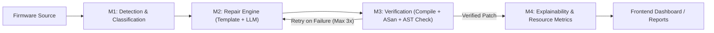

# IoT ShieldAI 🛡️

> **AI-Powered Vulnerability Detection, Autonomous Repair, and Rigorous Verification for C/C++ IoT Firmware.**

IoT ShieldAI is an end-to-end platform engineered to protect resource-constrained IoT devices. It analyzes C/C++ source code, identifies memory safety vulnerabilities, synthesizes deterministic and LLM-assisted patches, and rigorously verifies every fix inside a sandboxed environment via compilation, AddressSanitizer (ASan), UndefinedBehaviorSanitizer (UBSan), and an AST-level "no-cheating" heuristic.

---

## 1. System Architecture



---

## 2. Module Overview

| Module | Directory | Description | Responsibility |
|---|---|---|---|
| **M1: Analysis** | `backend/app/modules/m1_analysis/` | Static analysis (`cppcheck`, `semgrep`), AST code parsing, root cause analysis, severity scoring, DL classifier. | Detect vulnerabilities, map CWEs, extract code snippets. |
| **M2: Repair** | `backend/app/modules/m2_repair/` | Deterministic fix templates (`fix_templates/`), prompt builder, pluggable LLM client, patch generator & applier. | Generate safe C/C++ fixes; try rule-based templates first, fall back to LLM. |
| **M3: Verification** | `backend/app/modules/m3_verification/` | Clang/GCC compiler runner, AddressSanitizer / UBSan runtime tester, AST no-cheating check, feedback loop. | Verify patch compiles cleanly, triggers zero sanitizer errors, and preserves functionality. |
| **M4: Explainability** | `backend/app/modules/m4_explain_iot/` | Natural language patch explainer, IoT resource delta metrics (Flash/ROM, SRAM/Stack), report builder. | Quantify IoT resource impact and provide explainable security summaries. |
| **Frontend** | `frontend/` | React 18, Vite, Tailwind CSS, React Router, Axios. | Interactive multi-step UI for uploading, reviewing vulnerabilities, diffs, and verification metrics. |
| **Sandbox** | `sandbox/` | Hardened Docker environment with GCC, Clang, ASan, UBSan, Cppcheck, Semgrep. | Secure execution boundary isolating untrusted firmware compilation and runs. |

---

## 3. Team Responsibilities

| Team Member | Module Assignment | Primary Scope |
|---|---|---|
| **Member 1** | Module 1 (M1 Analysis) + Demo Samples | Static analysis parsers, severity rating, CWE mapping, and vulnerable demo firmware datasets. |
| **Member 2** | Module 2 (M2 Repair) | Fix template engine, regex/AST rules, LLM prompt engineering, and unified diff generator. |
| **Member 3** | Module 3 (M3 Verification) + Sandbox | Docker sandbox container, compiler harness, ASan/UBSan execution, and no-cheating heuristic. |
| **Member 4** | Frontend + Module 4 (M4 Explainability) | React dashboard, code diff viewer, IoT resource metrics (Flash/RAM delta), and report generation. |

---

## 4. Setup and Quickstart

### Prerequisites
- Python 3.11+
- Node.js 18+ and npm
- Docker (for sandbox verification)
- GCC / Clang (optional for local host compilation)

### 1. Backend Setup
```bash
cd backend
python -m venv .venv
# Activate environment:
# Windows: .venv\Scripts\activate
# Linux/macOS: source .venv/bin/activate
pip install -r requirements.txt

# Run FastAPI backend:
uvicorn app.main:app --reload --host 0.0.0.0 --port 8000
```
- Health Check: `http://localhost:8000/health`
- Interactive API Docs: `http://localhost:8000/docs`

### 2. Frontend Setup
```bash
cd frontend
npm install
npm run dev
```
- Web Application: `http://localhost:5173`

### 3. Docker Sandbox Setup
```bash
# Build the secure sandbox container
docker build -t iot-shieldai-sandbox sandbox/
```

---

## 5. How the Agent Maintains History, Skills, and Plan Reviews

To guarantee reproducibility, architectural integrity, and transparency during the 24-hour hackathon, every AI agent interaction follows strict rules:

1. **Mandatory Plan Review Gate (`.agent/rules/plan-review.md` & `review-implementation-plan` skill)**:
   - Before implementing any task, the agent produces an implementation plan.
   - The plan is reviewed against a 10-point checklist (scope, structure, order, tech stack, schema parity, stubs, OS validity, security, tracking, time budget).
   - Any failure triggers up to 3 iterative correction rounds before approval.
2. **Project History Log (`PROJECT_HISTORY.md`)**:
   - The single source of truth tracking Project Genesis, Module Status, Decisions Log, Known Issues, and Plan Review Log.
   - After every prompt or task, an immutable row is appended to the **Prompt Log** table.
3. **Skills Registry (`SKILLS.md` & `.agent/skills/`)**:
   - Repeatable workflows are formalized as reusable skills (e.g. adding demo firmware, adding fix templates, verifying patches).
4. **Parallel Error Checking (`scripts/check_all.ps1` & `scripts/check_all.sh`)**:
   - Automated checks validate Python compilation, linting, tests, frontend build, firmware syntax, and documentation integrity before any milestone is marked done.
