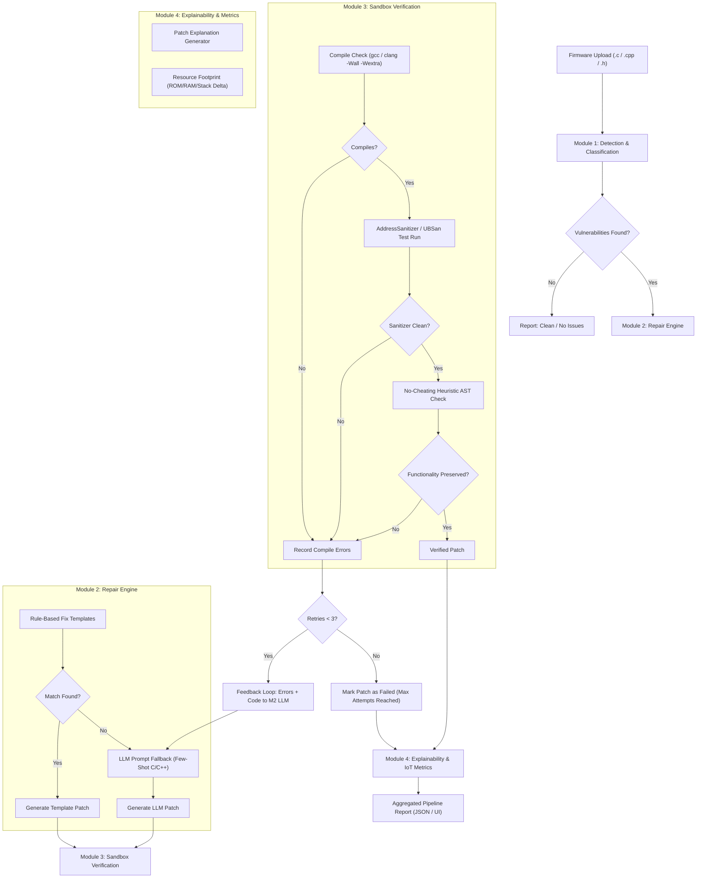

# IoT ShieldAI — System Architecture

## 1. Overview
**IoT ShieldAI** is an AI-powered system designed to detect, repair, and rigorously verify security vulnerabilities in C/C++ IoT firmware. The platform bridges the gap between automated patch generation and embedded systems safety by ensuring that no patch introduces new undefined behaviors, memory errors, or unintended functionality degradation.

---

## 2. Pipeline Flow (Section H)
The end-to-end remediation pipeline follows a closed-loop automated verification flow:

---

## 3. Core Modules

### Module 1: Detection & Classification (`m1_analysis`)
- **Static Analyzer (`static_analyzer.py`)**: Runs linters and static analysis tools (`cppcheck`, `semgrep`) inside the isolated container.
- **Code Parser (`code_parser.py`)**: Parses C/C++ source code, extracts syntax trees, and maps source line ranges.
- **Root Cause Analyzer (`root_cause.py`)**: Pinpoints why the vulnerability occurred (e.g., missing length check, unchecked pointer dereference).
- **Severity Classifier (`severity.py`)**: Classifies vulnerabilities into `Critical`, `High`, `Medium`, and `Low` using CVSS-aligned heuristics.
- **Deep Learning Classifier (`dl_classifier.py`)**: Pluggable lightweight ML classifier for zero-day and pattern-based vulnerability detection.

### Module 2: Automated Repair (`m2_repair`)
- **Fix Template Engine (`template_engine.py`, `fix_templates/`)**: Deterministic regex and AST replacement rules for high-frequency CWE patterns (e.g., `strcpy` $\to$ `strncpy` + NUL, `malloc` check insertions).
- **Prompt Builder (`prompt_builder.py`)**: Formats prompt contexts, original code snippets, compiler errors, and IoT coding guidelines.
- **LLM Client (`llm_client.py`)**: Pluggable interface supporting commercial APIs (e.g. Gemini, OpenAI) and local models (DeepSeek-Coder, CodeLlama).
- **Patch Generator (`patch_generator.py`)**: Produces unified diffs between original and candidate repaired code.
- **Patch Applier (`patch_applier.py`)**: Safely applies unified diffs or replacement blocks to source files.

### Module 3: Patch Verification (`m3_verification`)
- **Compiler Runner (`compiler.py`)**: Compiles patched firmware with strict warning flags (`-Wall -Wextra -Werror`).
- **Sanitizer Runner (`sanitizer_runner.py`)**: Executes compiled binaries with AddressSanitizer (`-fsanitize=address`) and UndefinedBehaviorSanitizer (`-fsanitize=undefined`).
- **No-Cheating Heuristic (`no_cheating_check.py`)**: Verifies that the patch does not simply remove the vulnerable function call, return early unconditionally, or delete essential device logic.
- **Feedback Loop Controller (`feedback_loop.py`)**: On verification failure, packages compiler warnings and ASan stack traces to feed back into M2 (up to 3 retry attempts).

### Module 4: Explainability & IoT Metrics (`m4_explain_iot`)
- **Patch Explainer (`explainer.py`)**: Generates clear, human-understandable explanations of what changed and why it is secure.
- **Resource Metrics (`resource_metrics.py`)**: Calculates IoT-critical resource implications:
  - Flash / ROM footprint delta (binary size).
  - Estimated SRAM / stack delta.
  - Cyclomatic complexity change.
- **Report Builder (`report_builder.py`)**: Assembles `PipelineResult` data for API consumption and downloadable reports.

---

## 4. Sandbox Isolation & Safety Boundaries
All firmware execution, untrusted C code compilation, and sanitizer runs occur strictly inside a hardened Docker sandbox:
- Non-root user execution.
- Read-only base filesystem with tmpfs mounts for ephemeral compilation.
- Strict memory and CPU resource caps (`ulimit`, memory limit 512MB).
- No network access inside the container during test runs (`--network none`).
